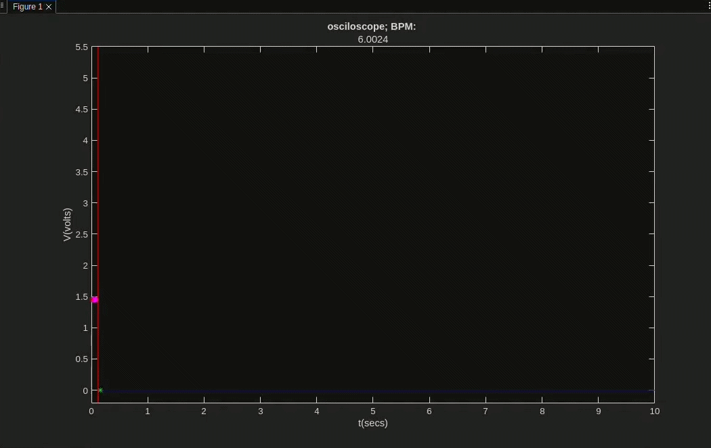
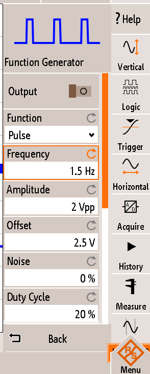
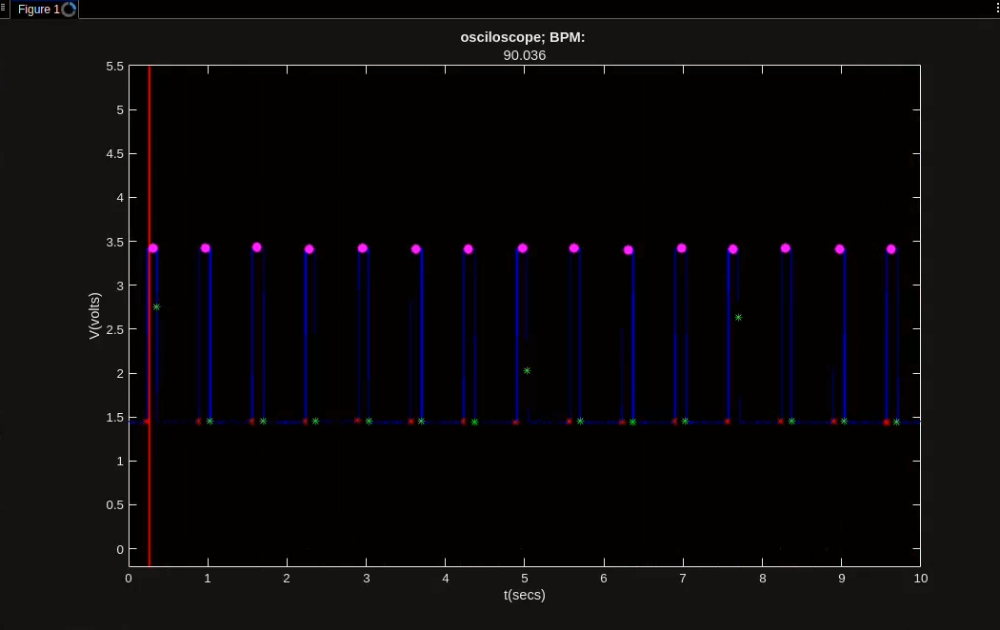
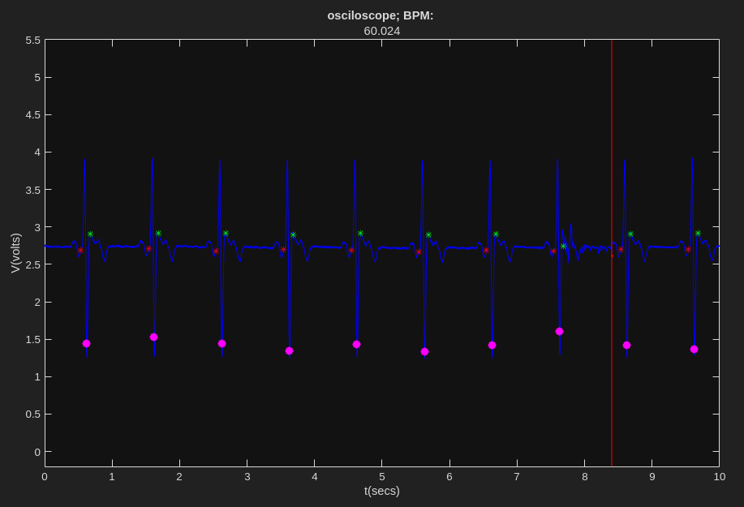

# Module 02 – ECG Project
**ECEN4532: Digital Signal Processing Laboratory (Spring 2026)**  
**Instructor:** Talles Santos  
**Students:**   Alyssa Jackson  
              Joshua Thomas  
              Emilie Teel  

## Introduction
  An electrocardiogram (shortened to ECG or EKG) procedure is a quick and simple test that is designed to record the eletrical signal from a patient's beating heart and use it to find its natural rhythmic cycle [1]. By placing electrodes aroud the patient's chest, arms, and/or legs, a circuit is created with the heart as the voltage source the contractions caused by electricity are pickeed up by the electrodes and sent to a circuit.


  
  *Figure 1: A diagram of the different parts of a heartbeat that are searched for during an ECG test [2].*

  This signal of the heartbeat, in the form of the "PQRST" complex as seen with Figure 1, is what needs to be detected in order to find important information about a patient's heart. Things like poor blood flow, arrhythmias, heart attacks, and thickened heart walls, can be picked up, seen, and diagnosed accurately with this type of circuit [4].  

  The goal of this project is not only to build an analog circuit that can pick up the signals of a heartbeat, but to then transmit that data using an Arduino Uno to MATLAB that will then visual said data from the heart and calculate the BPM (or the beats per minute) from the received signal.


## Methodology

### Hardware


*Figure 2: A diagram of the circuit that a body completes based on the position of the electrodes. A) represents the circuit on a body while B) shows the connections in the image space. [3]*  

As can be seen in Figure 2, the basic premise of the ECG Circuit itself involves building a voltage divider with the heart in order to pick up the signals ans input it into the circuit.

### Testing the Hardware

### Software
For the software side of things, an Arduino Uno R3 was used to take that normalized heartbeat signal, or a simple test signal generated from a function generator, that ranges from 0 to 5V and transmit the data to MATLAB via packets. The packets act like individual bundles of data that are all sent to the host computer running MATLAB in order instead of in a constant real time stream that would take more processing power and lead to potential data errors.  

But before the data is sent over, the MATLAB script must be formatted to in order to gather the data coming in from the Arduino at the correct speed and sampling frequency:  

```matlab
% define port
portName = serialportlist("available");
% portName = '/dev/ttyACM0' ;
% portName = '/dev/ttyACM1' ;
portName = '/dev/ttyUSB0' ;

% open port
fp = serialport(portName,115200);

% settings
fs = 1 / (3e-3) ;                          % sampling frequency of the arduino
sizeBufferArduino = 20 ;                   % from arduino code
t_Buffer = 10.0 ;                          % in seconds
nSamplesBuffer = round(t_Buffer*fs) ;      % nSamples of the circular buffer in the matlab script
bits2volts = 5/(2^10-1) ;                  % convertion from bits to volts (arduino uno 10 bits)

% initialing variables
CircularBuffer = zeros(nSamplesBuffer,1);
vecSamples = 0 ;
count=1;

``` 
*Code Snipet 1: The first lines from the MATLAB script 'read_serial_Nsamples_buffer.m'. These lines work to format everything from the baud rate being received, the sampling frequency that the signal is being measured at, the size of the data packets that are recieved at once, conversion of the Arduino value from 0 to 5 volts, and other variables needed in the plotting of the data in real-time.* 

That packet of 20 individual values from the Arduino is sent to a loop that can't be left without a Serial port disconnection or a manual code end caused by the user. That loop constantly looks for the start of the new incoming packet, packet into a vector that MATLAB can tranversed, enters that vector being evaluated, turns the value into a voltage thanks to the data conversion with a time attached to the value, and finally plotted on a constantly updating graph of voltage vs. time. A circular buffer is used so that a constant stream of voltages can be plotted in an ever-rotating plot that can be seen in Figure ? below.


*Figure 3: A gif that shows how the plotting of data works on MATLAB. The red vertical line acts as the real-time sweep as the signal gets plotted.*  

As can also be seen from Figure 3, there are also magneta dots and red and green stars on the signal as well. These are the marks that are meant to point to the what the R peak of a signal is as well as the right(green) and left(red) of that R peak, as explained below:

```matlab
% For the best and most accurate data, the inputted signal need to be 
% filtered first
function [R_loc, left, right, bpm]=identifyQRSComplex(signal,Fs)


R_loc = [];
left = [];
right = [];
bpm = NaN;
%% Preprocessing the signal for QRS detection
x = signal;

% Removing the DC Offset from the Signal
x = x - mean(x);

% Finding the Time Scale of the Signal
T = 1/Fs;
N = length(x);

t = (0:N-1)*T;

% Normalizing the Signal
Norm_signal = x.^2;
Norm_signal = Norm_signal / max(abs(Norm_signal));


% Finding the QRS Complex Peaks
h = ones (1,36)/36; % 0.1secs
% Apply filter
x = conv (Norm_signal ,h,'same');
x = x/max(abs(x));

max_h = max(x);
thresh = 2*mean(x);
poss_reg =(x>thresh*max_h)';

% left = find(diff([0 poss_reg'])==1);
% right = find(diff([poss_reg' 0])==-1);

if isempty(poss_reg)
      left = [];
      right = [];
    else
      left = find(diff([0, poss_reg(:)']) == 1);
      right = find(diff([poss_reg(:)' 0]) == -1);
end


% The R_loc variable is the location of the R values that make up a QRS
% Complex
for i=1:length(left)
    [R_value(i) R_loc(i)] = max(x(left(i):right(i)));
    R_loc(i) = R_loc(i)-1+left(i); % add offset
end

freq_heartbeat = length(left)/max(t);

% Convert frequency to beats per minute
bpm = freq_heartbeat * 60;

end
```
*Code Snipet 2: The 'identifyQRSComplex' function used in the MATLAB code to find the bpm, the R location from the QRS complex, and the left and right of the the R location.*  

The code from the above snipet is the entireity of the function, and it also has the added benefit of being able to calculate the bpm (or the frequency of a signal in the span of a minute) of the input signal, which is displayed at the top of the gif in Figure 3. When combined, the function from Code Snipet 2 and the MATLAB script, the entirity of the code can detect the peaks of a signal, mark its highest point, the immediate left and right of that peak, and the BPM (or the frequency per minute for non-heartbeat signals) of the signal that is detected through the Arduino Uno.


### Testing the Software

Testing the programming for both the Arduino and MATLAB itself is pretty simple: connect the Arduino to PC running the MATLAB script and view the real-time output from the A0 pin.  

Put the gif or image here.

To test the BPM calculation equation

  
*Figure 4: The settings used for the test signal input in the Arduino.*


  
*Figure 5: The image from the MATLAB srcipt running that shows the BPM of the signal, which is around 90 times a second for a minute, or around 1.5Hz.*

### Connecting the Hardware and Software

## Results


*Figure 6: The image from the MATLAB srcipt running that shows the BPM of the generated heartbeat signal, which is around 60 times a second for a minute, or around 1Hz.*  

## Conclusion


## References
1. https://www.mayoclinic.org/tests-procedures/ekg/about/pac-20384983

2. https://www.withings.com/us/en/health-insights/about-ecg-ekg-electrocardiogram?srsltid=AfmBOorydm8yKYhquxItaWKUVDFjAmXBAV8dxPpUkZrdyCu7soVGj3wy

3. https://www.researchgate.net/figure/A-The-circuit-of-the-Goldberger-augmented-leads-B-The-location-of-the-Goldberger_fig4_321019966

4. https://doralhw.org/condition/abnormal-electrocardiogram-ecg-ekg/

5. 