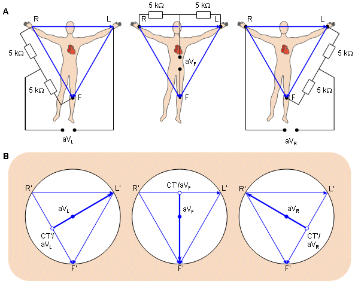
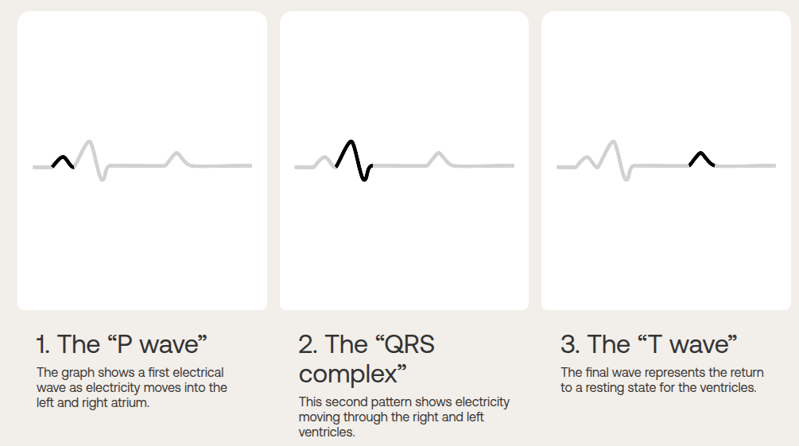

# Module 02 – ECG Project
**ECEN4532: Digital Signal Processing Laboratory (Spring 2026)**  
**Instructor:** Talles Santos  
**Students:**   Alyssa Jackson  
              Joshua Thomas  
              Emilie Teel  

## Introduction
  An electrocardiogram (shortened to ECG or EKG) procedure is a quick and simple test that is designed to record the eletrical signal from a patient's beating heart and use it to find its natural rhythmic cycle[1]. By placing electrodes aroud the patient's chest, arms, and/or legs, a circuit is created with the heart as the voltage source the contractions caused by electricity are pickeed up by the electrodes and sent to a circuit.

  
  *Figure 1: A diagram of the circuit that a body completes based on the position of the electrodes. A) represents the circuit on a body while B) shows the connections in the image space. [4]*


  


  
  *Figure 2: A diagram of the different parts of a heartbeat that are searched for during an ECG test [2].*

  1. https://www.mayoclinic.org/tests-procedures/ekg/about/pac-20384983

  2. https://www.withings.com/us/en/health-insights/about-ecg-ekg-electrocardiogram?srsltid=AfmBOorydm8yKYhquxItaWKUVDFjAmXBAV8dxPpUkZrdyCu7soVGj3wy

  3. https://www.researchgate.net/figure/A-The-circuit-of-the-Goldberger-augmented-leads-B-The-location-of-the-Goldberger_fig4_321019966

  4. 


## Methodology

### Hardware

### Software
For the software side of things, an Arduino Uno R3 was used to take that normalized heartbeat signal, or a simple test square wave generated from a function generator, that ranges from 0 to 5V and transmit the data to MATLAB via packets. The packets act like individual bundles of data that are all sent to the host computer running MATLAB in order instead of in a constant real time stream that would take more processing power and lead to potential data errors.  

But before the data is sent over, the MATLAB script must be formatted to in order to gather the data coming in from the Arduino at the correct speed and sampling frequency:  

```matlab
% define port
portName = serialportlist("available");
% portName = '/dev/ttyACM0' ;
% portName = '/dev/ttyACM1' ;
portName = '/dev/ttyUSB0' ;

% open port
fp = serialport(portName,115200);

% settings
fs = 1 / (3e-3) ;                          % sampling frequency of the arduino
sizeBufferArduino = 20 ;                   % from arduino code
t_Buffer = 10.0 ;                          % in seconds
nSamplesBuffer = round(t_Buffer*fs) ;      % nSamples of the circular buffer in the matlab script
bits2volts = 5/(2^10-1) ;                  % convertion from bits to volts (arduino uno 10 bits)

% initialing variables
CircularBuffer = zeros(nSamplesBuffer,1);
vecSamples = 0 ;
count=1;

``` 
*Code Snipet 1: The first lines from the MATLAB script 'read_serial_Nsamples_buffer.m'. These lines work to format everything from the baud rate being received, the sampling frequency that the signal is being measured at, the size of the data packets that are recieved at once, conversion of the Arduino value from 0 to 5 volts, and other variables needed in the plotting of the data in real-time.* 

That packet of 20 individual values from the Arduino is sent to a loop that can't be left without a Serial port disconnection or a manual code end caused by the user. That loop constantly looks for the start of the new incoming packet, packet into a vector that MATLAB can tranversed, enters that vector being evaluated, turns the value into a voltage thanks to the data conversion with a time attached to the value, and finally plotted on a constantly updating graph of voltage vs. time. 

### Connecting Hardware to Software

## Results

## Conclusion
